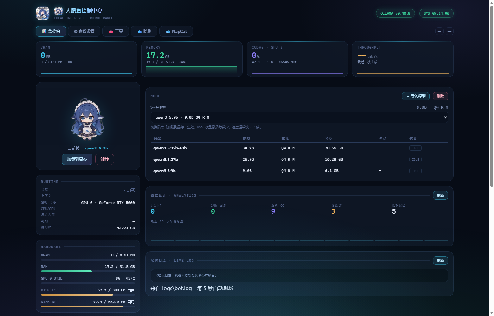

# 🐟 大肥鱼控制中心 · Local AI Console

一个**零依赖**的本地大模型控制台。单文件后端 + 单页前端，不需要 pip install，不需要 Node.js，双击一个 `bat` 就能跑。

> Zero-dependency local LLM dashboard. Pure Python stdlib + a single HTML file.



---

## 它解决什么问题

跑本地模型（Ollama）的时候，你通常要：

- 开一个终端跑 `ollama serve`
- 再开一个窗口 `ollama run`
- 想看显存占用，去开任务管理器
- 想改参数，去翻环境变量
- 想加载/卸载模型，敲命令

这个控制台把这些**全部收进一个网页**，并且尽量**自动探测**——不用手填路径、端口、显存。

---

## 功能

### 监控
- 显存 / 内存 / GPU 利用率 / 吞吐 实时曲线（自动探测，无需配置）
- 模型列表、加载状态、显存占用、上下文长度
- 磁盘剩余空间、GPU 温度、功耗、频率
- 实时日志滚动

### 控制
- **一键加载 / 卸载模型**（不用记命令）
- 模型切换、导入 GGUF、删除模型
- 参数调节：`num_ctx` / `temperature` / `top_p` / `top_k` / `repeat_penalty` / `think` / `keep_alive` / `num_gpu`
- **服务控制**：语言模型、语音引擎、QQ 机器人、托盘图标，各自独立启停，可设开机自启
- **一键内存清理**：扫描第三方后台进程，按「建议 / 使用中 / 未知」三级分类，带系统进程白名单

### 人设与预设
- 人设预设管理（系统提示词）
- 机器人预设（群聊行为、唤醒词、回复间隔）
- 唤醒词可随人设自动切换

### 其他
- 深色 UI，含角色装饰元素（可关）
- 服务运行状态自检（12 项），带一键更新
- 可选托盘图标

---

## 快速开始

### 环境要求

```
Windows 10/11
Python 3.9+      （只用标准库，无第三方依赖）
Ollama           （可选，没有也能启动控制台）
```

### 运行

```cmd
python app.py
```

然后浏览器打开 <http://127.0.0.1:8080>

或者用自带的启动器（会自动拉起 Ollama）：

```cmd
启动.bat
```

### 配置

首次运行会在 `data/` 下自动生成：

| 文件 | 说明 |
|---|---|
| `autostart.json` | 各服务的自启开关 |
| `.console_token` | 控制台访问令牌（自动生成） |

模型目录、Ollama 路径、端口都会**自动探测**。如果探测失败，用环境变量覆盖：

```cmd
set OLLAMA_BASE=http://127.0.0.1:11434
set OLLAMA_MODELS=D:\models
set FISHCHAT_PORT=8080
```

---

## 架构

```
app.py            HTTP 服务 + API + 自动探测（~1900 行，纯标准库）
static/index.html 单页前端（原生 JS，无框架）
data/             运行时数据（配置、令牌、数据库）
logs/             日志
```

没有构建步骤，没有 npm，改完刷新就生效。

---

## API 一览

| 方法 | 路径 | 说明 |
|---|---|---|
| GET | `/api/status` | 实时指标 |
| GET | `/api/selfcheck` | 12 项自检 + 版本 |
| GET/POST | `/api/config` | 读取/保存参数 |
| POST | `/api/load` `/api/unload` | 加载/卸载模型 |
| GET | `/api/models/gguf` | 扫描本地 GGUF |
| GET/POST | `/api/services` | 服务启停 + 自启设置 |
| GET | `/api/mem/scan` · POST `/api/mem/clean` | 内存扫描/清理 |
| GET | `/api/stats` | 用量统计 |
| GET | `/api/log` | 日志尾部 |

写操作需要请求头 `X-Auth-Token`（首次访问网页自动下发 cookie）。

---

## 安全说明

- 服务只监听 `127.0.0.1`
- 写接口需要令牌，防止本机其他程序或网页 CSRF
- 令牌存放于 `data/.console_token`，删除后自动重新生成

---

## 已知限制

- 仅支持 Windows（用到了 `tasklist`、`nvidia-smi`、注册表等）
- 显存/GPU 信息依赖 `nvidia-smi`，无 NVIDIA 显卡时降级显示
- 部分卡片（语音、QQ 机器人）需要配合其他组件，未安装时显示为「未启动」

---

## 致谢与第三方组件

控制台代码为本项目原创（MIT）。运行时**对接**以下开源项目，均**未打包**、需自行安装：

| 项目 | 用途 | 许可证 | 是否随本仓库分发 |
|---|---|---|---|
| [Ollama](https://github.com/ollama/ollama) | 本地推理引擎 | MIT | ❌ |
| [NapCatQQ](https://github.com/NapNeko/NapCatQQ) | QQ 机器人框架（可选） | Limited Redistribution License | ❌（禁止再分发） |
| [GPT-SoVITS](https://github.com/RVC-Boss/GPT-SoVITS) | 语音合成（可选） | MIT | ❌ |
| [edge-tts](https://github.com/rany2/edge-tts) | 语音备用引擎（可选） | LGPLv3 | ❌ |

> ⚠️ NapCatQQ 使用自定义许可证，**禁止再分发**，因此本仓库不包含其任何文件。
> 若你自行添加角色立绘、动作素材，另有授权要求（形象原型 CC BY-NC-SA 4.0，
> 动作素材来自 dsh-pet 且不可商用）。**本仓库不含任何图片或音频素材。**

完整说明见 [ACKNOWLEDGEMENTS.md](ACKNOWLEDGEMENTS.md)。

## 许可证

| 内容 | 许可证 |
|---|---|
| 代码（`app.py`、`static/`、`tools/`） | **MIT** |
| 文档（README、ACKNOWLEDGEMENTS） | CC BY 4.0 |
| 人设预设文本 | 随代码 MIT，但涉及的角色形象另有归属 |
| 角色图片 / 音频素材 | **不包含**，使用者自行负责 |

本项目为个人学习作品，与上述开源项目作者无隶属或背书关系。
